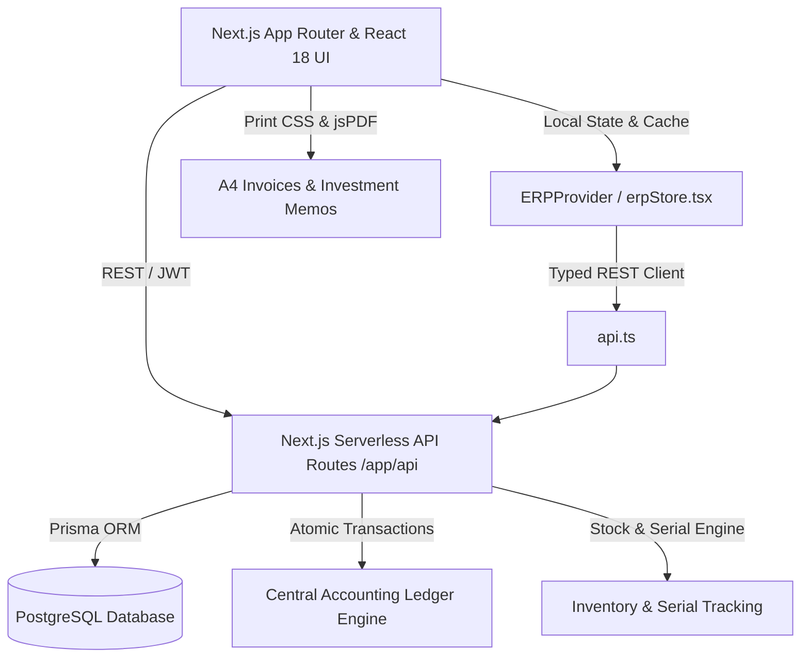
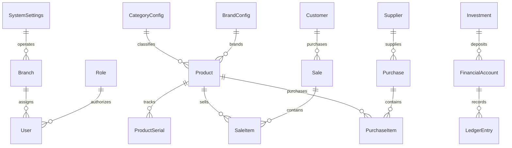

# NEED ELECTRO ERP — COMPLETE MASTER PROJECT PLAN & SYSTEM REPLICATION SPECIFICATION

> **Document Version**: 2.0.0 (Production Blueprint)  
> **Target System**: NEED ELECTRO ERP — Enterprise Multi-Module Business Management System  
> **Organization**: NEED ELECTRO — Trusted Electrical & Technological Solutions  
> **Parent / Engineering**: Amdads Group  
> **Target Deployment**: Clean Standalone Software Build (Zero Production Data)

---

## 1. Executive Summary & Objective

This document serves as the **Master Architectural Blueprint and End-to-End Implementation Plan** for creating a completely separate, clean, production-ready ERP software system based on the proven architecture, business workflows, accounting logic, inventory systems, and UI/UX behaviors of the existing **NEED ELECTRO ERP**.

The new software is **NOT an MVP, NOT a prototype, and NOT a UI mockup**. It is a fully functional, commercially viable, enterprise-grade business management system that operates with complete database-backed workflows, strict double-entry accounting integrity, automated serial tracking, comprehensive print/PDF document pipelines, and isolated initial setup capabilities.

---

## 2. Core Architectural Principles & Stack Definition



### 2.1 Technology Stack Matrix
- **Frontend Framework**: Next.js 14 (App Router) + React 18 + TypeScript 5.7+
- **Styling Architecture**: Vanilla CSS tokens + Tailwind CSS + Custom Responsive Layouts + Dark/Light Theme Engine
- **Icons & Visuals**: Lucide React (`lucide-react`) + Recharts Data Visualization
- **Backend & Server**: Next.js API Routes (`app/api/*`) executing in Node.js runtime
- **ORM & Data Layer**: Prisma ORM (`@prisma/client` 5.22+)
- **Database Engine**: PostgreSQL (Supabase-hosted relational cluster or standalone PostgreSQL)
- **Document Generation**: Vanilla CSS `@media print` + `html2canvas` + `jspdf`
- **Security & Cryptography**: JSON Web Tokens (`jsonwebtoken`), `bcryptjs`, Secure HttpOnly Session Management

---

## 3. Comprehensive Module Catalog (23 Integrated Modules)

| # | Module Name | Primary Responsibilities & Functional Surface |
| :--- | :--- | :--- |
| **01** | **Dashboard** | Real-time sales, purchases, expenses, cash drawer, bank accounts, receivables, payables, stock valuation, recent transactions. |
| **02** | **POS / Billing** | Barcode scanning, serial assignment, instant discount limits, split/custom payments, customer quick-add, auto-resize billing panel. |
| **03** | **Sales Management** | Invoices registry, payment status tracking, detailed invoice view with auto-populated laptop technical specifications. |
| **04** | **Sales Returns** | Return intake, stock return to inventory, customer balance credit / cash refund, ledger reversal. |
| **05** | **EMI / Installments** | Installment plans, guarantor profiling, interest/charge calculations, payment schedules, agreement printing. |
| **06** | **Inventory Management**| Stock quantity tracking, reorder thresholds, low stock alerts, stock adjustments, batch/serial movements. |
| **07** | **Product Management** | Product catalog, brand & category taxonomy, laptop technical specs matrix, supplier company name display enforcement. |
| **08** | **Serial Numbers** | Monospace serial tracking, status lifecycle (`AVAILABLE` → `SOLD` → `DEFECTIVE` → `RETURNED`), warranty binding. |
| **09** | **Purchase Orders** | Supplier purchase orders, receiving workflows, cost tracking, serial registration upon arrival, payable tracking. |
| **10** | **Supplier Management** | Supplier profile directory, complete contact details, purchase ledger, payment execution, supplier return tracking. |
| **11** | **Customer Management** | Customer directory, receivables ledger, transaction history, credit limits, phone-based search. |
| **12** | **Customer Payments** | Payment intake against open receivables, account allocation (Cash/Bank/bKash/Nagad), automated receipt. |
| **13** | **Supplier Payments** | Payment disbursement reducing supplier payables and decrementing selected financial account. |
| **14** | **Expense Management** | Categorized operational expenses, direct account deduction, expense receipts, recurring expense logs. |
| **15** | **Investments** | Investor directory, equity/debt investments, account inflow, Central Ledger synchronization. |
| **16** | **Investment Memos** | Professional A4 portrait memo generation, number-to-words in English & Bengali, PDF export with zero extra transactions. |
| **17** | **Cash Management** | Multi-account vault (Main Cash, Bank Accounts, bKash, Nagad), account transfers, balance reconciliation, adjustments. |
| **18** | **Central Accounting** | Central Ledger, Trial Balance, Balance Sheet, Profit & Loss statement, chart of accounts. |
| **19** | **Reports & Analytics** | Sales reports, purchase reports, expense statements, customer/supplier dues, cash flow, stock movements. |
| **20** | **Service & Repairs** | Repair intake, technician assignment, spare parts usage, job cards, service billing. |
| **21** | **Warranty Management** | Serial-based warranty lookup, warranty claim registration, replacement/repair tracking, vendor warranty claims. |
| **22** | **Employee & HR** | Staff directory, salary records, daily attendance tracking, branch permissions. |
| **23** | **Control Center & Audit**| Initial Setup Wizard, system settings, VAT/BIN configuration, automated audit logs, database backup/restore. |

---

## 4. Deep-Dive Business Logic & Accounting Specifications

### 4.1 Central Ledger & Multi-Account Engine
All financial movements must strictly maintain double-entry correctness and update running account balances atomically within a database transaction:

```
[Financial Transaction Occurs]
       │
       ▼
┌──────────────────────────────────────────────┐
│  Resolve Account (Main Cash, Bank, bKash...) │
└──────────────────────┬───────────────────────┘
                       │
         ┌─────────────┴─────────────┐
         ▼                           ▼
┌──────────────────┐       ┌──────────────────┐
│   INFLOW (Debit) │       │ OUTFLOW (Credit) │
│  Balance += Amt  │       │  Balance -= Amt  │
└────────┬─────────┘       └─────────┬────────┘
         │                           │
         └─────────────┬─────────────┘
                       ▼
┌──────────────────────────────────────────────┐
│  Create LedgerEntry with Running Balance     │
│  Reference: INV / PUR / EXP / TRF / MEM      │
└──────────────────────────────────────────────┘
```

1. **Cash Sale**:
   - `FinancialAccount` (e.g. Main Cash) balance increments by paid amount.
   - `LedgerEntry` created: `partyType='ACCOUNT'`, `debit=amount`, `credit=0`, `referenceType='SALE'`.
   - `InventoryTransaction` created: stock decreases.
2. **Credit Sale**:
   - `FinancialAccount` balance increments ONLY by the amount received at checkout.
   - Customer's `receivable` balance increments by the unpaid due balance.
   - `LedgerEntry` reflects only the real cash inflow.
3. **Purchase (Cash & Credit)**:
   - `FinancialAccount` balance decrements ONLY by the paid amount.
   - Supplier's `payable` balance increments by the unpaid due amount.
   - `InventoryTransaction` created: stock increases; serials registered as `AVAILABLE`.
4. **Account Transfers (Contra Entries)**:
   - Source Account balance decrements (`TRANSFER_OUT`).
   - Destination Account balance increments (`TRANSFER_IN`).
   - **Crucial Rule**: Account transfers must NEVER be classified as revenue or expenses.
5. **Safe Transaction Reversal**:
   - Original transaction is NEVER hard-deleted.
   - Status updated to `REVERSED`.
   - Counteracting `REVERSAL` ledger entry generated (`REF = REV-[ORIGINAL]`).
   - Audit trail permanently logged.

### 4.2 Laptop Specifications & Tech Product Engine
Laptops and serialized electronics require rich technical attributes that must flow seamlessly from Product Setup to Inventory, Sales, and Invoices:

- **Attributes**: Brand, Model, Processor (e.g., Intel Core i7 13th Gen, Apple M2), RAM (e.g., 16GB DDR5), Storage (e.g., 512GB NVMe SSD), Display (e.g., 15.6" FHD 144Hz IPS), Graphics (e.g., NVIDIA RTX 4060 8GB), OS (e.g., Windows 11 Pro), Condition (Brand New / Refurbished / Like New), Serial Number, Warranty Period.
- **Invoice Formatting Rule**:
  - The invoice generator (`invoiceSpecsHelper.ts`) must auto-format specifications into clean badge/spec cards.
  - **No empty fields**: Unspecified attributes are suppressed automatically.
  - Serial numbers must be displayed in distinct monospace typography with explicit warranty expiration dates.

### 4.3 Supplier Display Policy
- **Product & Inventory Screens**: Show ONLY the supplier company name (e.g., "Green Tech Sales"). Personal contact names and personal phone numbers must be hidden from product context.
- **Supplier Module**: Complete supplier details (contact person, phone, email, address, balance, purchase history) are fully displayed.

### 4.4 Investment Memo System
- **Layout**: Strict A4 portrait format.
- **Header**: Official NEED ELECTRO logo, business addresses, BIN, email, phone.
- **Reference**: Auto-incremented memo code (`INV-YYYY-XXXXXX`).
- **Data Attributes**: Investor Name, NID/Passport, Phone, Email, Address, Organization, Investment Amount, Amount in Words (both English and Bengali conversion), Payment Method, Deposit Account, Investment Type (Equity/Loan), Purpose, Terms.
- **Signatures**: Dual signature blocks (Investor Signature & Authorized Executive Signature).
- **Export**: Built-in 1-click Browser Print (`@media print` clean layout) and 1-click high-resolution PDF download using vector `jspdf` + `html2canvas`.
- **Accounting Isolation**: Generating, viewing, or printing a memo creates NO duplicate ledger movements.

---

## 5. Production-Ready Database Schema Specification



### Complete Entity List (54 Database Models)
1. **System & Enterprise**: `SystemSettings`, `PosSettings`, `InventoryRules`, `SetupStatus`.
2. **Organization & Multi-Branch**: `Branch`.
3. **Authentication & RBAC**: `User`, `Role`, `Permission`, `Session`, `LoginHistory`.
4. **Catalog & Taxonomy**: `CategoryConfig`, `BrandConfig`, `Product`, `ProductSerial`.
5. **Trading & Transactions**: `Customer`, `Supplier`, `Sale`, `SaleItem`, `Purchase`, `PurchaseItem`, `ProductReturn`.
6. **EMI / Financing**: `EMIPlan`, `EMIAccount`, `EMIInstallment`, `EMIPayment`.
7. **Cash & Accounting**: `FinancialAccount`, `ConfigurablePaymentMethod`, `LedgerEntry`, `FundTransfer`, `Investment`, `Investor`, `Expense`, `ExpenseCategoryConfig`, `OpeningBalance`, `CashAdjustment`, `CashReconciliation`, `CustomerPayment`, `SupplierPayment`, `OtherIncome`, `OwnerWithdrawal`.
8. **Technical Services & Warranty**: `ServiceJob`, `Technician`, `ServiceCategoryConfig`, `WarrantyRuleConfig`, `WarrantyClaim`.
9. **Human Resources**: `Employee`, `Attendance`.
10. **Auditing & Monitoring**: `AuditLog`, `PriceAudit`, `CustomerMergeAudit`, `NotificationTemplateConfig`, `DatabaseBackup`.

---

## 6. Zero Production Data Policy & Initial Setup Wizard

To guarantee the new software is a separate, clean, and uncompromised system:
1. **Zero Personal Data**: No existing customer names, supplier personal phone numbers, or employee personal data will be seeded.
2. **Zero Financial History**: All financial accounts start at `0.00` BDT with no prior transactional ledger clutter.
3. **Clean Seeding Baseline**:
   - Master Roles: `SUPER_ADMIN`, `ADMIN`, `MANAGER`, `SALES_EXECUTIVE`, `ACCOUNTANT`, `TECHNICIAN`, `INVESTOR`.
   - Core Financial Accounts: Main Cash Drawer, Standard Bank Accounts, bKash Merchant Wallet, Nagad Merchant Wallet.
   - Standard Taxonomy: Product categories (Laptops, Desktops, CCTV, Accessories) and expense categories (Rent, Utilities, Salaries).
4. **First-Run Installation Wizard (`InitialSetupModal.tsx`)**:
   - When `SetupStatus.initialSetupCompleted === false`:
   - System prompts for Super Admin Account creation (Name, Email, Phone, Password).
   - System prompts for Enterprise Profile (Business Name, Address, Contact, Currency).
   - Upon submission, marks `initialSetupCompleted = true` and unlocks the ERP dashboard.

---

## 7. Responsive Layout & UI/UX Standards

1. **POS Auto-Resizing**:
   - Removed all hardcoded height restrictions.
   - Responsive breakpoints (1280px, 1100px, 900px stack).
   - Sticky checkout panel ensuring the "Complete Sale" action is always visible without scrolling the outer page.
2. **Modal Body Scrolling**:
   - Every creation/edit modal implements `display: flex; flex-direction: column; max-height: 90vh`.
   - Modal headers and modal footers (with Save/Cancel buttons) remain permanently pinned.
   - Modal bodies scroll internally (`overflow-y: auto`).
3. **High-Contrast Dark & Light Mode**:
   - Input controls, select dropdowns, and tabular data maintain WCAG 2.1 AA compliant contrast ratios.
   - Seamless switching via top navigation bar.
4. **Print Isolation**:
   - All print documents use `@media print` rules hiding navigation bars, sidebars, buttons, and app frames.
   - Margins configured specifically for A4 (portrait) and 80mm POS Thermal receipt printers.

---

## 8. The 14 Implementation Phases & Execution Roadmap

```
PHASE 01: Full System Inspection & Component Auditing [COMPLETED]
   │
PHASE 02: Architecture & Entity Relationship Modeling [COMPLETED]
   │
PHASE 03: Database Blueprint & Clean Migration Schema Generation
   │
PHASE 04: Project Scaffolding & Directory Setup
   │
PHASE 05: Authentication, RBAC & First-Run Setup Wizard
   │
PHASE 06: Catalog, Laptop Specs & Serial Number Tracking
   │
PHASE 07: Supplier, Customer & Multi-Account Cash Vault
   │
PHASE 08: Purchase Order & Inventory Movement Pipeline
   │
PHASE 09: POS Billing, Credit Sales & Sales Return Engine
   │
PHASE 10: Central Ledger Synchronization & Safe Reversals
   │
PHASE 11: A4 Invoices, Thermal Receipts & Investment Memos (PDF/Print)
   │
PHASE 12: Business Intelligence, Analytics & Financial Statements
   │
PHASE 13: End-to-End Automated Testing & Type Verification
   │
PHASE 14: Production Build, CI/CD Pipeline & Cloud Deployment
```

---

## 9. 39-Step End-to-End Acceptance Test Workflow

Before certifying the new ERP software as production-ready, the following sequential acceptance test must pass without error:

```
[1. First Run Wizard] ──► Create Super Admin ──► Configure Enterprise Settings
         │
[2. Master Setup]     ──► Add Branch ──► Add Accounts (Cash, Bank, bKash, Nagad)
         │
[3. Catalog Entry]    ──► Create Category ──► Create Brand ──► Add Laptop with Specs
         │
[4. Purchasing]       ──► Create Supplier ──► Add Purchase Order ──► Assign Serials
         │                 ├── Verify Inventory Stock Increase (+1)
         │                 ├── Verify Supplier Balance Increase (Payable)
         │                 └── Verify Financial Account Decrease by Paid Amount
         │
[5. POS / Sales]      ──► Select Customer ──► Scan Serial ──► Complete Sale
         │                 ├── Verify Inventory Stock Decrease (-1)
         │                 ├── Verify Serial Status: SOLD with Warranty Expiry
         │                 ├── Verify Account Increase by Received Amount
         │                 └── Verify Customer Balance Increase by Due Amount
         │
[6. Documents]        ──► View Invoice ──► Verify Laptop Specs Rendered ──► Print A4 ──► Download PDF
         │
[7. Collections]      ──► Customer Makes Due Payment ──► Verify Cash Inflow & Balance Drop
         │
[8. Disbursements]    ──► Pay Supplier Due Balance ──► Verify Cash Outflow & Payable Drop
         │
[9. Expenses]         ──► Record Office Expense ──► Verify Account Balance Deducted
         │
[10. Transfers]       ──► Transfer from Main Cash to Eastern Bank ──► Verify Both Accounts (Contra)
         │
[11. Investments]     ──► Record Investment ──► Account Inflow ──► Print Investment Memo ──► Download PDF
         │
[12. Returns]         ──► Return Sale ──► Verify Stock Restored ──► Verify Financial Effect
         │            ──► Return Purchase ──► Verify Stock Deducted ──► Verify Supplier Balance Corrected
         │
[13. Financials]      ──► Verify Central Ledger ──► Generate Trial Balance & P&L Statements
         │
[14. Security]        ──► Logout ──► Login Again ──► Refresh `/sales` ──► Verify Route Preserved
```

---

## 10. Summary & Sign-Off

This document constitutes the complete blueprint for reproducing the **NEED ELECTRO ERP** as an independent, fully featured, secure, and production-tested software system. All code implemented under this plan adheres strictly to the zero-production-data mandate, full double-entry accounting integrity, and automated CI/CD deployment standards.
