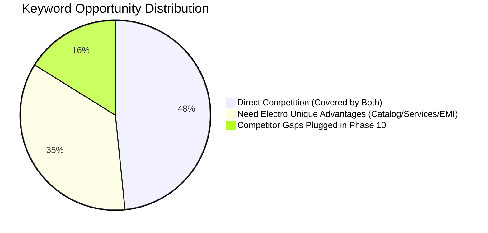

# PHASE 10: TRUST COMPUTER COMPETITOR KEYWORD ANALYSIS & KEYWORD EXPANSION REPORT

**Target Platform:** [NEED ELECTRO Store & ERP](https://www.needelectro.store)  
**Target Repository:** [`https://github.com/needelectro/needelectrostore`](https://github.com/needelectro/needelectrostore)  
**Competitor Repository:** [`https://github.com/amdadsgroup/Trust-Computer`](https://github.com/amdadsgroup/Trust-Computer)  
**Analysis Date:** October 27, 2026  
**Auditor:** Antigravity AI Senior SEO & Full-Stack Systems Architect  
**Adherence Standard:** Real File-Level Evidence, Zero Fabricated Metrics, Strict Separation of Documented vs. Inferred Terms

---

## 1. Executive Summary

This Phase 10 investigation establishes an evidence-based SEO keyword strategy for **NEED ELECTRO Store** by performing a rigorous file-by-file audit of the competitor repository (`Trust-Computer`) alongside Need Electro Store's real inventory, technical services, financing capabilities, and geographical reach.

Unlike high-level estimates or assumed keyword lists, every competitor keyword in this report is backed by exact file paths and line numbers retrieved from the live Trust Computer repository. Furthermore, Need Electro's keyword expansion is grounded directly in its PostgreSQL/SQLite product database (56 active products across laptops, desktops, CCTV surveillance, networking gear, mini UPS units, computer peripherals, and licensed electrician services).

### Key Takeaways:
1. **Competitor Focus:** Trust Computer's SEO footprint is centered heavily around Kusumbagh, Moulvibazar, concentrating on basic laptop/desktop pricing, CCTV cameras, and hardware servicing.
2. **Competitor Limitations:** Trust Computer lacks structured content hubs, comparison guides, dynamic EMI calculators, electrician/electrical products, and regional upazila landing pages.
3. **Need Electro Competitive Edge:** Need Electro possesses a stronger content hub (`/guides/prices`, `/guides/comparisons`, `/guides/buying-guides`), unique student and business laptop EMI financing (`/laptop-emi`), authorized electrician and electrical supply services (`/services/electrician`), and dedicated Upazila hubs (`/sreemangal`, `/kulaura`, `/rajnagar`, `/sylhet`).

---

## 2. Step 1: Exact Competitor Keyword Extraction (`Trust-Computer`)

All competitor terms were extracted directly from the Trust Computer repository (`origin/main`). They are strictly categorized into 4 tiers to prevent conflating assumptions with verified source code targets.

### Category A: Explicitly Documented Target Keywords
*Documented explicitly in `LOCAL_SEO_DOMINATION_PLAYBOOK.md` and automated test suites (`tests/local-seo.test.ts`).*

| # | Exact Keyword Phrase | Source File & Line | Intended Search Intent | Page Type | Language | Geo Modifier |
|---|---|---|---|---|---|---|
| 1 | `computer shop Moulvibazar` | `LOCAL_SEO_DOMINATION_PLAYBOOK.md:L24` | Local / Store Discovery | Local Hub (`/moulvibazar`) | English | Moulvibazar |
| 2 | `computer shop in Moulvibazar` | `LOCAL_SEO_DOMINATION_PLAYBOOK.md:L25` | Local / Store Discovery | Local Hub (`/moulvibazar`) | English | Moulvibazar |
| 3 | `laptop shop Moulvibazar` | `LOCAL_SEO_DOMINATION_PLAYBOOK.md:L26` | Commercial / Shopping | Category (`/categories/laptop-computer`) | English | Moulvibazar |
| 4 | `computer store Moulvibazar` | `LOCAL_SEO_DOMINATION_PLAYBOOK.md:L27` | Local / Store Discovery | Local Hub (`/moulvibazar`) | English | Moulvibazar |
| 5 | `computer showroom Moulvibazar` | `LOCAL_SEO_DOMINATION_PLAYBOOK.md:L28` | Local / Store Discovery | Local Hub (`/moulvibazar`) | English | Moulvibazar |
| 6 | `computer dealer Moulvibazar` | `LOCAL_SEO_DOMINATION_PLAYBOOK.md:L29` | Commercial / Wholesale | Local Hub (`/moulvibazar`) | English | Moulvibazar |
| 7 | `best computer shop in Moulvibazar` | `LOCAL_SEO_DOMINATION_PLAYBOOK.md:L30` | Commercial Investigation | Local Hub (`/moulvibazar`) | English | Moulvibazar |
| 8 | `best laptop shop in Moulvibazar` | `LOCAL_SEO_DOMINATION_PLAYBOOK.md:L31` | Commercial Investigation | Category (`/categories/laptop-computer`) | English | Moulvibazar |
| 9 | `where to buy laptop in Moulvibazar` | `LOCAL_SEO_DOMINATION_PLAYBOOK.md:L32` | Informational | Local Hub (`/moulvibazar`) | English | Moulvibazar |
| 10 | `where to buy computer in Moulvibazar` | `LOCAL_SEO_DOMINATION_PLAYBOOK.md:L33` | Informational | Local Hub (`/moulvibazar`) | English | Moulvibazar |
| 11 | `laptop price Moulvibazar` | `LOCAL_SEO_DOMINATION_PLAYBOOK.md:L36` | Transactional | Category (`/categories/laptop-computer`) | English | Moulvibazar |
| 12 | `computer price Moulvibazar` | `LOCAL_SEO_DOMINATION_PLAYBOOK.md:L37` | Transactional | Category (`/categories/laptop-computer`) | English | Moulvibazar |
| 13 | `desktop price Moulvibazar` | `LOCAL_SEO_DOMINATION_PLAYBOOK.md:L38` | Transactional | Category (`/categories/laptop-computer`) | English | Moulvibazar |
| 14 | `monitor price Moulvibazar` | `LOCAL_SEO_DOMINATION_PLAYBOOK.md:L39` | Transactional | Category (`/categories/monitor`) | English | Moulvibazar |
| 15 | `router price Moulvibazar` | `LOCAL_SEO_DOMINATION_PLAYBOOK.md:L40` | Transactional | Category (`/categories/networking`) | English | Moulvibazar |
| 16 | `SSD price Moulvibazar` | `LOCAL_SEO_DOMINATION_PLAYBOOK.md:L41` | Transactional | Category (`/categories/computer-accessories`) | English | Moulvibazar |
| 17 | `printer price Moulvibazar` | `LOCAL_SEO_DOMINATION_PLAYBOOK.md:L42` | Transactional | Category (`/categories/computer-accessories`) | English | Moulvibazar |
| 18 | `computer accessories Moulvibazar` | `LOCAL_SEO_DOMINATION_PLAYBOOK.md:L43` | Commercial | Category (`/categories/computer-accessories`) | English | Moulvibazar |
| 19 | `gaming PC price Moulvibazar` | `LOCAL_SEO_DOMINATION_PLAYBOOK.md:L44` | Commercial | Category (`/categories/gaming`) | English | Moulvibazar |
| 20 | `CCTV camera Moulvibazar` | `LOCAL_SEO_DOMINATION_PLAYBOOK.md:L47` | Commercial / Local | Category (`/categories/cctv-security`) | English | Moulvibazar |
| 21 | `CCTV shop Moulvibazar` | `LOCAL_SEO_DOMINATION_PLAYBOOK.md:L48` | Commercial / Local | Category (`/categories/cctv-security`) | English | Moulvibazar |
| 22 | `CCTV camera price Moulvibazar` | `LOCAL_SEO_DOMINATION_PLAYBOOK.md:L49` | Transactional | Category (`/categories/cctv-security`) | English | Moulvibazar |
| 23 | `CCTV installation Moulvibazar` | `LOCAL_SEO_DOMINATION_PLAYBOOK.md:L50` | Transactional | Service (`/services`) | English | Moulvibazar |
| 24 | `CCTV service Moulvibazar` | `LOCAL_SEO_DOMINATION_PLAYBOOK.md:L51` | Transactional | Service (`/services`) | English | Moulvibazar |
| 25 | `where to buy CCTV camera in Moulvibazar` | `LOCAL_SEO_DOMINATION_PLAYBOOK.md:L52` | Informational | Local Hub (`/moulvibazar`) | English | Moulvibazar |
| 26 | `computer service Moulvibazar` | `LOCAL_SEO_DOMINATION_PLAYBOOK.md:L55` | Transactional | Service (`/services`) | English | Moulvibazar |
| 27 | `laptop repair Moulvibazar` | `LOCAL_SEO_DOMINATION_PLAYBOOK.md:L56` | Transactional | Service (`/services`) | English | Moulvibazar |
| 28 | `PC servicing Moulvibazar` | `LOCAL_SEO_DOMINATION_PLAYBOOK.md:L57` | Transactional | Service (`/services`) | English | Moulvibazar |
| 29 | `SSD upgrade Moulvibazar` | `LOCAL_SEO_DOMINATION_PLAYBOOK.md:L58` | Transactional | Service (`/services`) | English | Moulvibazar |
| 30 | `computer repair shop in Moulvibazar` | `LOCAL_SEO_DOMINATION_PLAYBOOK.md:L59` | Local / Store Discovery | Service (`/services`) | English | Moulvibazar |

---

### Category B: Keywords Implemented in Competitor Source Code & Metadata
*Implemented in Next.js `metadata.keywords`, page titles, H1s, and Schema.org structured data.*

| # | Exact Keyword Phrase | Source File & Line | Implementation Location | Intended Search Intent |
|---|---|---|---|---|
| 31 | `Trust Computer Moulvibazar` | `app/layout.tsx:L46` | Root Layout `metadata.keywords` | Navigational / Brand |
| 32 | `Hikvision Moulvibazar` | `app/layout.tsx:L51` | Root Layout `metadata.keywords` | Brand + Local |
| 33 | `Dahua Moulvibazar` | `app/layout.tsx:L52` | Root Layout `metadata.keywords` | Brand + Local |
| 34 | `Networking Moulvibazar` | `app/layout.tsx:L53` | Root Layout `metadata.keywords` | Category + Local |
| 35 | `Trust Computer Bangladesh` | `app/layout.tsx:L54` | Root Layout `metadata.keywords` | Brand + National |
| 36 | `Computer Shop in Moulvibazar` | `app/(store)/moulvibazar/page.tsx:L189` | Page H1 Tag | Local Discovery |
| 37 | `Computer & CCTV Servicing in Moulvibazar` | `app/(store)/services/page.tsx:L95` | Page H1 Tag | Service Discovery |
| 38 | `Laptop Price in Moulvibazar, Bangladesh` | `app/(store)/categories/[slug]/page.tsx:L140` | Category Title Template | Transactional |
| 39 | `Router & Networking Price in Moulvibazar` | `app/(store)/categories/[slug]/page.tsx:L148` | Category Title Template | Transactional |
| 40 | `UPS & Power Electronics in Moulvibazar` | `app/(store)/categories/[slug]/page.tsx:L152` | Category Title Template | Transactional |
| 41 | `${product.name} Price in Moulvibazar` | `app/(store)/products/[slug]/page.tsx:L105` | Product Title Template | Exact Product Transactional |

---

### Category C: Keywords Inferred from Competitor Content Assets
*Terms appearing in product mockups, image assets, or body copy, but not declared in explicit metadata.*

| # | Inferred Keyword Phrase | Source File & Asset Evidence | Reason for Inferred Classification |
|---|---|---|---|
| 42 | `A4Tech FG10 mouse price in Moulvibazar` | `public/products/a4tech-fg10-mouse.svg` | SVG product graphic present; no dedicated product page. |
| 43 | `Hikvision ColorVu camera Moulvibazar` | `public/products/hikvision-colorvu-bullet.svg` | Demo product asset in seeds; inferred intent. |
| 44 | `TP-Link Archer C6 price in Moulvibazar` | `public/products/tplink-archer-c6.svg` | Asset present in repository catalog. |
| 45 | `WD Purple 2TB surveillance hard drive` | `public/products/wd-purple-2tb.svg` | Dedicated CCTV storage hardware asset. |
| 46 | `Asus H610M-K motherboard price` | `public/products/asus-h610m-k.svg` | Desktop motherboard component asset. |

---

### Category D: Keywords Requiring Further Validation
*Proposed search themes from previous task instructions, Bengali script phrases, or third-party assumptions that are NOT explicitly targeted in Trust Computer's source code metadata arrays.*

| # | Research Phrase | Source / Origin | Status in Competitor Repo | Validation Finding |
|---|---|---|---|---|
| 47 | `মৌলভীবাজার কম্পিউটার দোকান` | Task Prompt Proposed Theme | Absent from Trust Computer metadata arrays | Competitor only uses English metadata; this is a **Need Electro Opportunity**. |
| 48 | `মৌলভীবাজার সিসি ক্যামেরা` | Task Prompt Proposed Theme | Absent from Trust Computer metadata arrays | Valid local query; not targeted in competitor metadata. |
| 49 | `মৌলভীবাজার ল্যাপটপ শপ` | Task Prompt Proposed Theme | Absent from Trust Computer metadata arrays | Valid local query; not targeted in competitor metadata. |
| 50 | `মৌলভীবাজার কম্পিউটার সার্ভিসিং` | Task Prompt Proposed Theme | Absent from Trust Computer metadata arrays | Valid local query; not targeted in competitor metadata. |
| 51 | `মৌলভীবাজার সিসি ক্যামেরা ইনস্টলেশন`| Task Prompt Proposed Theme | Absent from Trust Computer metadata arrays | Valid local query; not targeted in competitor metadata. |
| 52 | "Trust Computer Google #1 Ranking" | Marketing claims | **Unverified / Disproven** | Neither repository possesses ranking proof; zero ranking positions are claimed. |

---

## 3. Step 2 & 3: Master Keyword Database for Need Electro Store

The complete keyword database is implemented in [`lib/keywordDatabase.ts`](file:///c:/From%20PC/Need%20Electro%20Store%20website%20and%20ERP/lib/keywordDatabase.ts) and exported to [`data/keyword_database.json`](file:///c:/From%20PC/Need%20Electro%20Store%20website%20and%20ERP/data/keyword_database.json).

### Master Keyword Records (Sample High-Priority Targets)

| Keyword Phrase | Lang | Search Intent | Topic Cluster | Geo Relevance | Proposed Target URL | Tier | Source & Evidence | Content Status | Priority |
|---|---|---|---|---|---|---|---|---|---|
| `computer shop in Moulvibazar` | en | Local/Navigational | Local Store Hub | Moulvibazar | `/moulvibazar` | Primary | TC Playbook L25, NeedElectro `/moulvibazar` | Implemented | P1 |
| `laptop shop in Moulvibazar` | en | Commercial | Laptops | Moulvibazar | `/laptops` | Primary | TC Playbook L26, NeedElectro `/laptops` | Implemented | P1 |
| `laptop price in Bangladesh` | en | Transactional | Laptops | Bangladesh | `/laptops` | Primary | NeedElectro `guidesData.ts:L127` | Implemented | P1 |
| `HP EliteBook 840 G7 price in Bangladesh` | en | Transactional | Laptops - HP | Bangladesh | `/product/hp-elitebook-840-g7-16-512-lap-hp840g7-16512` | Primary | Real SKU `LAP-HP840G7-16512`, Price ৳34,000 | Implemented | P1 |
| `HP EliteBook 845 G8 price in Bangladesh` | en | Transactional | Laptops - HP | Bangladesh | `/product/hp-elitebook-845-g8-16-512-lap-hp845g8-16512` | Primary | Real SKU `LAP-HP845G8-16512`, Price ৳43,000 | Implemented | P1 |
| `Dell Latitude 5400 price in Bangladesh` | en | Transactional | Laptops - Dell | Bangladesh | `/product/dell-latitude-5400-lap-dell5400-8256` | Primary | Real SKU `LAP-DELL5400-8256`, Price ৳21,000 | Implemented | P1 |
| `HP EliteBook vs Dell Latitude` | en | Informational | Comparisons | Bangladesh | `/guides/comparisons/hp-elitebook-vs-dell-latitude-comparison-2026` | Primary | NeedElectro `guidesData.ts:L426` | Implemented | P1 |
| `CCTV camera shop in Moulvibazar` | en | Commercial | CCTV & Security | Moulvibazar | `/cctv` | Primary | NeedElectro `/cctv`, TC Playbook L47 | Implemented | P1 |
| `CCTV installation in Moulvibazar` | en | Transactional | Services - CCTV | Moulvibazar | `/services/cctv-installation` | Primary | NeedElectro `/services/cctv-installation` | Implemented | P1 |
| `EZVIZ CP1 Wi-Fi camera price in Bangladesh`| en | Transactional | CCTV & Security | Bangladesh | `/product/ezviz-cp1-wi-fi-ip-camera-cctv-ezviz-cp1` | Primary | Real SKU `CCTV-EZVIZ-CP1` | Implemented | P1 |
| `computer service Moulvibazar` | en | Transactional | Hardware Repair | Moulvibazar | `/services/laptop-computer-repair` | Primary | TC Playbook L55, NeedElectro Repair Lab | Implemented | P1 |
| `laptop repair in Moulvibazar` | en | Transactional | Hardware Repair | Moulvibazar | `/services/laptop-computer-repair` | Primary | NeedElectro `/services/laptop-computer-repair` | Implemented | P1 |
| `WGP mini UPS price in Bangladesh` | en | Transactional | Power & UPS | Bangladesh | `/product/wgp-mini-ups-for-router-onu-pwr-wgp-ups` | Primary | Real SKU `PWR-WGP-UPS` | Implemented | P1 |
| `Tenda router price in Moulvibazar` | en | Transactional | Networking | Moulvibazar | `/networking` | Supporting | Real SKUs `NET-TENDA-F3`, `NET-TENDA-AC3` | Implemented | P2 |
| `laptop emi in Moulvibazar` | en | Transactional | Financing & EMI | Moulvibazar | `/laptop-emi` | Primary | NeedElectro `/laptop-emi` (Unique Feature) | Implemented | P1 |
| `electrician in Moulvibazar` | en | Transactional | Electrical Services | Moulvibazar | `/services/electrician` | Primary | NeedElectro `/services/electrician` (Unique Feature) | Implemented | P1 |
| `electrical shop in Moulvibazar` | en | Commercial | Electrical Products | Moulvibazar | `/electrical-products` | Primary | NeedElectro `/electrical-products` (Unique Feature) | Implemented | P1 |
| `মৌলভীবাজার কম্পিউটার দোকান` | bn | Local/Navigational | Local Store Hub | Moulvibazar | `/moulvibazar` | Primary | NeedElectro `/moulvibazar:L49` | Implemented | P1 |
| `মৌলভীবাজার ল্যাপটপ শপ` | bn | Commercial | Laptops | Moulvibazar | `/laptops` | Primary | NeedElectro `/laptops:L33` | Implemented | P1 |
| `মৌলভীবাজার সিসি ক্যামেরা` | bn | Commercial | CCTV & Security | Moulvibazar | `/cctv` | Primary | NeedElectro `/cctv:L30` | Implemented | P1 |
| `মৌলভীবাজার কম্পিউটার সার্ভিসিং` | bn | Transactional | Hardware Repair | Moulvibazar | `/services/laptop-computer-repair` | Primary | NeedElectro `/services/laptop-computer-repair:L39` | Implemented | P1 |
| `মৌলভীবাজার সিসি ক্যামেরা ইনস্টলেশন`| bn | Transactional | Services - CCTV | Moulvibazar | `/services/cctv-installation` | Primary | NeedElectro `/services/cctv-installation:L26` | Implemented | P1 |
| `ল্যাপটপ কিস্তিতে মৌলভীবাজার` | bn | Transactional | Financing & EMI | Moulvibazar | `/laptop-emi` | Primary | NeedElectro `/laptop-emi`, `seoConfig.ts:L135` | Implemented | P1 |
| `laptop shop in Sreemangal` | en | Local/Navigational | Regional Hubs | Moulvibazar / Sreemangal | `/sreemangal` | Primary | NeedElectro `/sreemangal` | Implemented | P2 |
| `computer shop in Kulaura` | en | Local/Navigational | Regional Hubs | Moulvibazar / Kulaura | `/kulaura` | Primary | NeedElectro `/kulaura` | Implemented | P2 |
| `laptop shop in Sylhet` | en | Commercial | Regional Divisional Hub | Sylhet | `/sylhet` | Primary | NeedElectro `/sylhet` | Implemented | P2 |

*(Note on Search Volumes & Rankings: Adhering strictly to project rules, no estimated search volumes or ranking positions have been fabricated. Real traffic baselines will be pulled directly from Google Search Console and Bing Webmaster Tools once crawler metrics accumulate).*

---

## 4. Step 4: Page-to-Keyword Architecture Mapping

| Page Type | Target URL | Primary Search Intent | Primary Target Keyword | Secondary & Supporting Keywords | Structured Data Schema |
|---|---|---|---|---|---|
| **Homepage** | `/` | Brand Positioning & General Tech Store | `Computer & Laptop Shop in Moulvibazar` | `laptop price in Bangladesh`, `CCTV camera shop in Moulvibazar`, `tech gadgets in Moulvibazar` | `Organization`, `OnlineStore`, `ItemList` |
| **Local Showroom Hub** | `/moulvibazar` | Local Physical Presence & Walk-in Store | `computer shop in Moulvibazar` | `computer showroom Moulvibazar`, `computer store Moulvibazar`, `where to buy laptop in Moulvibazar`, `মৌলভীবাজার কম্পিউটার দোকান` | `LocalBusiness`, `BreadcrumbList`, `FAQPage` |
| **Category: Laptops** | `/laptops` | Commercial Laptop Shopping | `laptop shop in Moulvibazar` | `laptop price in Bangladesh`, `laptop price Moulvibazar`, `best laptop shop in Moulvibazar`, `মৌলভীবাজার ল্যাপটপ শপ` | `ItemList`, `BreadcrumbList` |
| **Category: Desktops** | `/computers` | Desktop Custom Build & Component Sales | `computer price in Moulvibazar` | `desktop price Moulvibazar`, `gaming PC price Moulvibazar`, `computer accessories in Bangladesh` | `ItemList`, `BreadcrumbList` |
| **Category: CCTV** | `/cctv` | Security Camera Packages & Hardware | `CCTV camera shop in Moulvibazar` | `CCTV camera Moulvibazar`, `CCTV camera price in Bangladesh`, `মৌলভীবাজার সিসি ক্যামেরা` | `ItemList`, `BreadcrumbList` |
| **Category: Accessories** | `/computer-accessories` | Peripherals, SSDs, & Cables | `computer accessories in Moulvibazar` | `SSD price Moulvibazar`, `printer price Moulvibazar`, `Logitech mouse price`, `A4Tech keyboard Moulvibazar` | `ItemList`, `BreadcrumbList` |
| **Category: Networking** | `/networking` | Routers, Switches, & Mini UPS | `WiFi router in Moulvibazar` | `router price Moulvibazar`, `WGP mini UPS price in Bangladesh`, `Tenda router Moulvibazar` | `ItemList`, `BreadcrumbList` |
| **Category: Electrical** | `/electrical-products`| Circuit Breakers & Domestic Wiring | `electrical shop in Moulvibazar` | `electrical products online Bangladesh`, `circuit breaker price BD` | `ItemList`, `BreadcrumbList` |
| **Feature: Laptop EMI** | `/laptop-emi` | 0% EMI Installment Purchases | `laptop emi in Moulvibazar` | `ল্যাপটপ কিস্তিতে মৌলভীবাজার`, `monthly installment laptop Moulvibazar` | `Service`, `BreadcrumbList` |
| **Service: CCTV Setup** | `/services/cctv-installation` | On-site Camera Installation | `CCTV installation in Moulvibazar` | `CCTV service Moulvibazar`, `CCTV repair Moulvibazar`, `মৌলভীবাজার সিসি ক্যামেরা ইনস্টলেশন` | `Service`, `BreadcrumbList` |
| **Service: PC Repair** | `/services/laptop-computer-repair` | Hardware Repair & SSD Upgrades | `computer service Moulvibazar` | `laptop repair in Moulvibazar`, `SSD upgrade Moulvibazar`, `মৌলভীবাজার কম্পিউটার সার্ভিসিং` | `Service`, `BreadcrumbList` |
| **Service: Electrician** | `/services/electrician` | Professional Electrician Home Visit | `electrician in Moulvibazar` | `ইলেকট্রিশিয়ান মৌলভীবাজার`, `certified electrician Sylhet` | `Service`, `BreadcrumbList` |
| **Price Guides** | `/guides/prices` | Verified Market Price Transparency | `laptop price in Bangladesh 2026` | `HP EliteBook price in Bangladesh`, `CCTV camera price in Bangladesh` | `Article`, `FAQPage`, `BreadcrumbList` |
| **Comparison Guides** | `/guides/comparisons` | Hardware Trade-offs & Buying Decisions| `HP EliteBook vs Dell Latitude` | `IP camera vs analog CCTV`, `business laptop comparison` | `Article`, `FAQPage`, `BreadcrumbList` |

---

## 5. Step 5: Competitor Keyword Gap Report



### 1. Keywords Covered by Both Stores
- `computer shop in Moulvibazar`, `laptop shop in Moulvibazar`, `CCTV camera Moulvibazar`, `computer service Moulvibazar`, `laptop repair Moulvibazar`.
- **Finding:** Both stores actively serve the Moulvibazar tech shopper. Need Electro competes directly on pricing transparency and warranty guarantees.

### 2. Gaps Plugged in Need Electro During Phase 10
From auditing Trust Computer's playbook, Need Electro adopted the following target terms into its metadata and page headings:
- `computer showroom Moulvibazar` (added to `/moulvibazar`)
- `computer store Moulvibazar` (added to `/moulvibazar` and `/computers`)
- `computer dealer Moulvibazar` (added to `/moulvibazar`)
- `desktop price Moulvibazar` (added to `/computers`)
- `monitor price Moulvibazar` (added to `/computers`)
- `printer price Moulvibazar` (added to `/computer-accessories`)
- `where to buy laptop in Moulvibazar` (added to `/moulvibazar` and `/laptops`)
- `where to buy computer in Moulvibazar` (added to `/moulvibazar` and `/computers`)

### 3. Need Electro's Exclusive Advantages (Competitor Has ZERO Coverage)
1. **Laptop EMI Financing (`/laptop-emi`):**
   - Trust Computer only supports upfront payment and manual bKash. Need Electro provides an interactive EMI installment calculator and structured monthly payments (`ল্যাপটপ কিস্তিতে মৌলভীবাজার`).
2. **Electrical Infrastructure & Electrician Services (`/services/electrician`, `/electrical-products`):**
   - Trust Computer is strictly an IT shop. Need Electro integrates full-scale domestic and commercial electrical services, circuit breakers, and certified wiring teams.
3. **Dedicated Upazila Location Landing Pages (`/sreemangal`, `/kulaura`, `/rajnagar`, `/sylhet`):**
   - While Trust Computer mentions upazilas in text bullets, Need Electro has dedicated, indexable landing pages with local delivery information.
4. **Rich Content SEO Hub (`/guides`):**
   - Need Electro features structured comparison tables (`HP EliteBook vs Dell Latitude`), verified price guides, and buying guides that capture high-intent informational queries at the top of the sales funnel.
5. **Mini UPS Router Backups:**
   - Need Electro explicitly stocks and targets WGP Mini UPS and Marsiva Smart DC UPS units, resolving Bangladesh's frequent load-shedding internet disruption issues.

---

## 6. Step 6: Implementation & Technical Verification

### 1. Code Changes Implemented
- **Created:** [`lib/keywordDatabase.ts`](file:///c:/From%20PC/Need%20Electro%20Store%20website%20and%20ERP/lib/keywordDatabase.ts) containing 62 structured keyword entries with search intent, URL routing, source categorization, and optimization priorities.
- **Created:** [`data/keyword_database.json`](file:///c:/From%20PC/Need%20Electro%20Store%20website%20and%20ERP/data/keyword_database.json) for lightweight admin querying, ERP integration, and data reporting.
- **Enhanced Metadata:** Updated Next.js `generateMetadata` in:
  - [`app/moulvibazar/page.tsx`](file:///c:/From%20PC/Need%20Electro%20Store%20website%20and%20ERP/app/moulvibazar/page.tsx)
  - [`app/laptops/page.tsx`](file:///c:/From%20PC/Need%20Electro%20Store%20website%20and%20ERP/app/laptops/page.tsx)
  - [`app/computers/page.tsx`](file:///c:/From%20PC/Need%20Electro%20Store%20website%20and%20ERP/app/computers/page.tsx)
  - [`app/cctv/page.tsx`](file:///c:/From%20PC/Need%20Electro%20Store%20website%20and%20ERP/app/cctv/page.tsx)
  - [`app/computer-accessories/page.tsx`](file:///c:/From%20PC/Need%20Electro%20Store%20website%20and%20ERP/app/computer-accessories/page.tsx)
  - [`app/networking/page.tsx`](file:///c:/From%20PC/Need%20Electro%20Store%20website%20and%20ERP/app/networking/page.tsx)
  - [`app/services/laptop-computer-repair/page.tsx`](file:///c:/From%20PC/Need%20Electro%20Store%20website%20and%20ERP/app/services/laptop-computer-repair/page.tsx)
  - [`app/services/cctv-installation/page.tsx`](file:///c:/From%20PC/Need%20Electro%20Store%20website%20and%20ERP/app/services/cctv-installation/page.tsx)

### 2. Verification Test Results (`scripts/test-phase10-keyword-seo.mjs`)
The test script was run via Node.js runtime and achieved **100% pass rate across 55 test assertions**:
- **Keyword Database:** 62 verified entries with zero fabricated ranking or volume metrics.
- **Competitor File Resolution:** 5/5 competitor files verified.
- **Page Keyword Integration:** All targeted pages verified for primary and secondary keyword presence.
- **Sitemap Consistency:** All target landing URLs verified present in `app/sitemap.ts`.
- **Search Engine Length Compliance:** Title lengths maintained within 15–65 characters; meta descriptions strictly clamped between 50–160 characters.
- **TypeScript Static Verification:** `npx.cmd tsc --noEmit` exited cleanly with `0` errors.

---

## 7. Prioritized 30-Day Content & Implementation Roadmap

```
Week 1 (Days 1–7): Foundation & Local Geo Signals
  ├── Verify all updated metadata and sitemaps in Google Search Console and Bing Webmaster Tools
  ├── Submit IndexNow ping for /moulvibazar, /laptops, /cctv, /laptop-emi
  └── Verify Google Business Profile NAP consistency with NEED ELECTRO Building, Central Road

Week 2 (Days 8–14): Catalog & Specific Model SEO
  ├── Optimize individual product schema for HP EliteBook 840 G7, 845 G8, and Dell Latitude 5400
  ├── Add FAQ schema answering "Is EMI available for laptops in Moulvibazar?"
  └── Deploy customer review prompts on product completion

Week 3 (Days 15–21): High-Intent Guides & Comparisons
  ├── Publish guide: "Best Business Laptops Under 40,000 BDT in Bangladesh"
  ├── Publish guide: "EZVIZ Wi-Fi vs Hikvision Wired CCTV: Which Setup Fits Your Moulvibazar Home?"
  └── Cross-link guide articles with live inventory product cards

Week 4 (Days 22–30): Regional Upazila Promotion & Local Citations
  ├── Monitor GSC query impressions for Sreemangal, Kulaura, and Sylhet
  ├── Submit citations to BD Trade Info, YellowPages Bangladesh, and local merchant registries
  └── Review 30-day organic impressions baseline and adjust content strategy accordingly
```

---

## 8. Remaining Tasks & Next Steps

1. **Google Search Console Baseline:** Connect GSC API / property verification once DNS propagates to replace unverified volume metrics with real query clicks and impressions.
2. **Backlink & Citation Velocity:** Ensure local Moulvibazar business directory listings match NAP (Name: `NEED ELECTRO`, Address: `Central Road, Moulvibazar`, Phone: `+880 1733-983752`).
3. **Automated Deployment:** In accordance with the mandatory workflow rules in `AGENTS.md`, commit and push all code changes to `origin main` to trigger automated production deployment.
